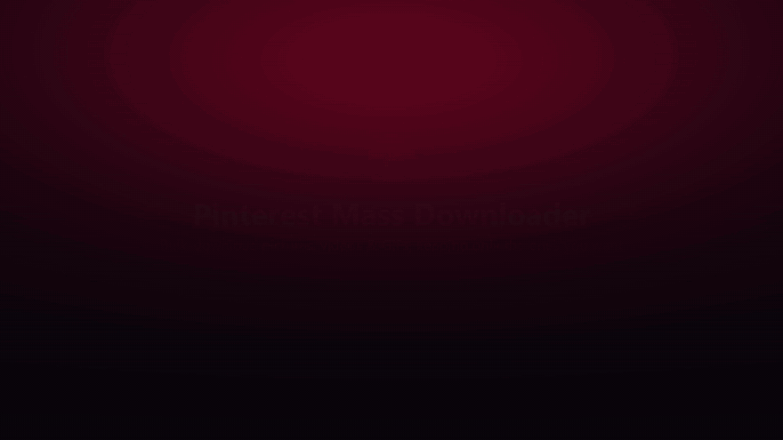
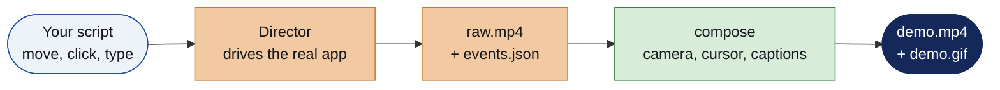

<h1 align="center">Demotive</h1>
<p align="center"><b>Scripted, polished demo videos of your desktop app.</b><br>
Write the walkthrough once as a short Python script. Demotive plays it, records the window, and edits the take for you.</p>

<p align="center">


<a href="LICENSE"></a>
</p>

<p align="center"></p>
<p align="center"><sub>Made with Demotive: the <a href="https://github.com/IamOumarIbrahim/pinterest-mass-downloader-gui">Pinterest Mass Downloader</a> walkthrough. Script: <a href="examples/pinterest_mass_downloader.py">examples/pinterest_mass_downloader.py</a>.</sub></p>

## How it works



Your real mouse and keyboard are never touched. The script calls your widgets directly and logs where the cursor *should* be. The composer then draws everything on top of the recording:

- **Camera zooms** onto each step, with smooth eased pans
- **A smooth cursor** with click ripples, and a slightly smaller pointer while dragging
- **Numbered step captions** at the bottom
- **Fast-forward** through waiting parts, with a `4× fast-forward` badge
- **Files dragged in** from the edge of the screen
- **Intro and outro cards**, a backdrop and a window shadow
- **1080p MP4 plus a GIF preview** sized for GitHub READMEs

## Quickstart

```bash
git clone https://github.com/IamOumarIbrahim/Demotive.git
cd Demotive
pip install -r requirements.txt
```

Write a script next to your app:

```python
from demotive import Director
from myapp import App

app = App()

def script(d):
    yield from d.caption("Search for anything")
    yield from d.focus(app.search, zoom=1.5)
    yield from d.move(app.search)
    yield from d.click()
    yield from d.type(app.search, "cats")

    yield from d.caption("Press Go")
    yield from d.focus(None)
    yield from d.move(app.go_button)
    yield from d.click(app.go_button.invoke)
    yield from d.speed(4)
    yield from d.until(lambda: app.done)
    yield from d.speed(1)
    yield from d.wait(2)

Director(app, "takes/first").run(script)
```

Then turn the take into a video:

```bash
python -m demotive.compose takes/first demo.mp4 --gif demo.gif \
    --logo M --title "My App" --subtitle "Does the thing, fast" \
    --outro-title "Get started" --outro-line "pip install myapp"
```

## Script steps

| Step | What it does |
| :--- | :--- |
| `d.move(widget or (x, y), dur=0.7)` | Glide the cursor there |
| `d.click(action=None)` | Click ripple; runs `action` at the same moment |
| `d.type(entry, "text", cps=11)` | Type into an entry, letter by letter |
| `d.drag_slider(slider, to)` | Grab the knob and drag it (a CTkSlider's command fires as it moves) |
| `d.scroll(canvas, to)` | Smooth scroll (0 = top, 1 = bottom) |
| `d.drag_file(path, onto, on_drop)` | Drag a file's thumbnail in from the screen edge and drop it |
| `d.caption("text")` / `d.caption(None)` | Show the next numbered caption / hide it |
| `d.focus(widget, zoom=1.45)` / `d.focus(None)` | Zoom the camera onto a widget / zoom back out |
| `d.speed(4)` ... `d.speed(1)` | Fast-forward everything in between |
| `d.wait(seconds)` / `d.until(condition)` | Pause / wait until something finishes |

`Director(app, workdir, size=(1320, 860), pos=(300, 70), fps=30)` sets the window size and position for the take. Keep the window fully on screen and uncovered while it records (it stays on top by default).

## Compose options

| Flag | Default | |
| :--- | :--- | :--- |
| `--gif PATH` | | Also write a GIF preview |
| `--gif-width` / `--gif-fps` | 880 / 10 | GIF size; smaller is lighter for READMEs |
| `--title`, `--subtitle`, `--logo` | | Intro card (skipped when no title) |
| `--outro-title`, `--outro-subtitle`, `--outro-line` | | Outro card; `--outro-line` repeats for several code lines |
| `--accent` | `#e60023` | Colour of captions, badges and the logo |
| `--fonts` | `C:/Windows/Fonts/` | Folder with Segoe UI and Consolas |

## Good to know

- **Works with** Tkinter and CustomTkinter apps. Other toolkits only need their own Director (the capture and compose steps are toolkit-agnostic).
- **Windows** is the tested platform. Capture uses Pillow's `ImageGrab`, and the default fonts are Windows fonts.
- **Keep secrets off camera.** Point your app at a throw-away settings folder for the take, like the example does with `APPDATA`.
- **Re-takes are cheap:** change the script and run it again. Compose takes about two minutes for a one-minute video.

## License

[MIT](LICENSE) © 2026 Oumar Ibrahim
